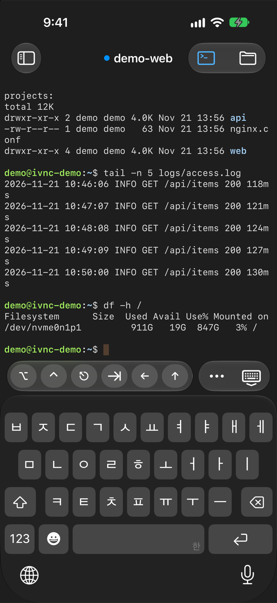
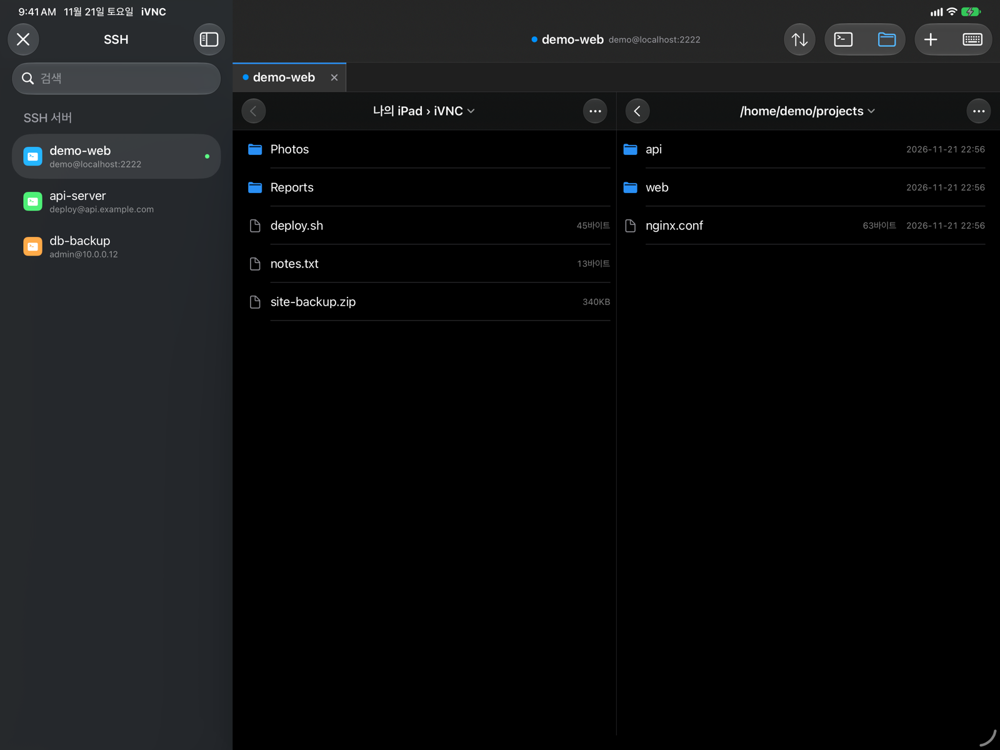

# iVNC

아이폰·아이패드·맥에서 **맥(화면 공유)**과 **윈도우(원격 데스크톱)**에 접속하는 원격 화면 앱입니다. 서버 관리를 위한 **SSH 터미널과 파일 주고받기**도 들어 있습니다.

*A remote screen app for iPhone, iPad and Mac that connects to macOS Screen Sharing (VNC/ARD, including High Performance mode) and Windows Remote Desktop (RDP) — plus an SSH terminal with an SFTP file browser.*

### 맥


### 아이폰

| 목록 | 열린 탭 · 서버 | 파인더 | 터미널 |
|:---:|:---:|:---:|:---:|
|  |  |  |  |

### 아이패드

| 목록 | 화면 공유 |
|:---:|:---:|
|  |  |

| 파인더 | 터미널 |
|:---:|:---:|
|  |  |

<sub>스크린샷의 서버·원격 화면은 시연용으로 만든 것입니다.</sub>

## 기능

**맥에 접속 (VNC / Apple Remote Desktop)**
- 맥 계정으로 로그인 (애플 인증, 키 입력은 암호화해서 보냄)
- 모니터 고르기, 모니터별 미리보기
- **고성능 모드**: 애플 화면 공유의 가상 디스플레이를 HEVC 영상(UDP/SRTP)으로 받음. 해상도를 기기에 맞출 수 있음
- 한글 입력: 이 기기의 한/영 상태에 맞춰 원격 입력 소스를 바꿈
- 원격 커서 모양, 클립보드 공유(글자·그림)

**윈도우에 접속 (RDP, FreeRDP)**
- NLA 로그인 (로컬 계정·Microsoft 계정·`도메인\사용자`)
- 그래픽 파이프라인 + H.264 (VideoToolbox 해독)
- 맥 단축키 그대로: ⌘C·⌘V → Ctrl+C·Ctrl+V, ⌘ 단독 → 윈도우 키, ⌘←/→ → Home/End, ⌘Q → Alt+F4
- 한/영 맞추기, 원격 커서 모양, 클립보드 공유(글자·그림)
- 처음 본 인증서는 기억하고, 바뀌면 묻기

**SSH 터미널 · 파인더**
- 탭으로 여러 서버를 함께 열기 (맥: 창·분할·탭 끌기, 아이패드: 사이드바 + 탭 줄, 아이폰: 옆 메뉴에 열린 탭 · 서버 목록)
- 비밀번호 또는 키 파일 인증, 경유 서버(배스천), 서버마다 색 표시, 문자 인코딩
- 한글 입력이 맥 기본 터미널처럼 자연스럽게, 특수 키 줄(⌃ ⌥ ⇥ 화살표 F1–F12)
- 파인더: 이 기기 ↔ 서버 두 칸, 끌어서 업로드 · 다운로드, 폴더째 옮기기, 이름 바꾸기 · 삭제
- 전송 내역(⇅): 한 번에 보낸 묶음과 파일마다 진행 막대, 남은 파일 수 배지
- 터미널에서 `sudo su` 로 바꾼 사용자 그대로 파일을 다룸 (맥)
- 서버 편집 창에서 저장하기 전에 접속 시험 (맥)

**MCP 서버 (맥)** — Claude Code 같은 AI 에이전트가 iVNC 를 통해 서버를 다룸 (`http://127.0.0.1:8767/mcp`, 이 맥 안에서만)
- 범위(모든 서버 · 열린 탭의 서버 · 활성 탭)와 권한(읽기만 · 안전한 명령만 · 위험한 명령은 확인 후 · 모두 자동)을 고름. 위험한 일은 iVNC 에서 허락해야 실행
- 명령 실행, 서버 상태 조회(앱이 정한 읽기 명령만), 열린 터미널 화면 읽기 · 입력, 파일 목록 · 읽기 · 쓰기 · 지우기, 원격 화면 그림
- **root 로 실행**: 서버마다 root 를 쓸 수 있는지 알려 주고(root 로 접속 · 열린 터미널의 root 셸 · 암호 없는 sudo), 그중 되는 방법을 iVNC 가 골라 씀. 안 되면 "터미널에서 sudo su 해 주세요" 로 거절
- **올리기**: 파일 · 폴더, 임시 이름으로 올린 뒤 바꿔치기(실패해도 원래 파일은 그대로), 권한 · 소유자 유지 또는 지정, 원래 파일을 서버에 `.bak-날짜시각` 으로 남기고 이 맥으로도 받아 두기 — 인증서 갱신 같은 일을 허락 한 번에
- **받기**: 파일 · 폴더, 남이 못 읽던 파일(개인 키 등)은 이 맥에서도 남이 못 읽게
- SFTP 가 꺼진 서버(시놀로지 등)는 명령 채널로 대신 주고받음. 접속 · 응답이 없으면 기다리지 않고 이유(VPN 확인 등)를 알림

**공통**
- 아이폰·아이패드: 터치 모드와 트랙패드 모드, 화면 확대·이동, 특수 키 줄
- 맥: 키를 원격으로 바로 보내거나(⌨︎) 이 맥에서 조합해 보내기(가), 시스템 단축키(⌘Tab 등)를 원격으로 보내기
- 컴퓨터 목록 순서 바꾸기(☰ 정렬 모드)
- **접속 허용 IP · VPN 안내**: 컴퓨터마다 들어갈 수 있는 IP 를 적어 두면 접속 전에 이 기기의 IP 를 확인(Wi-Fi · 이더넷 · VPN 마다 공인 IP 를 따로 확인). 아니면 접속하지 않고 VPN 을 켜라고 안내 — 맥은 시스템 설정의 VPN 목록에서 바로 켜고, 연결되면 이어서 접속. 경유 서버를 거치면 경유 서버의 목록으로 확인
- 원격 화면 해상도 설정, 컴퓨터 목록 · 순서 · SSH 설정 iCloud 동기화(글자 크기는 기기마다), 암호와 SSH 키는 iCloud 키체인
- 화면 미리보기(썸네일)를 iCloud Drive 로 기기끼리 나눔 — 이 기기에서 접속한 적 없는 컴퓨터도 다른 기기에서 본 화면이 보임
- 서버 지문은 기기마다 따로 확인

## 요구 사항

- iOS / iPadOS 26 이상, macOS 26 이상 (맥 앱은 Apple 실리콘 전용)
- 맥 쪽: 시스템 설정 > 일반 > 공유 > 화면 공유 켜기 (고성능 모드는 macOS 14 이상의 Apple 실리콘 맥)
- 윈도우 쪽: 설정 > 시스템 > 원격 데스크톱 켜기 (Windows Pro 이상)

## 빌드

Xcode 26 이상. 대상은 `iVNC`(아이폰·아이패드)와 `iVNCMac`(맥) 두 개이고 `iVNC` 폴더를 함께 씁니다.

윈도우 접속에 쓰는 FreeRDP 는 저장소에 넣지 않았습니다. 먼저 정적 라이브러리를 빌드해 `Vendor/FreeRDP.xcframework` 를 만들어야 합니다.

```bash
Scripts/rdp/build-openssl.sh
Scripts/rdp/build-freerdp.sh macos
Scripts/rdp/build-freerdp.sh ios
Scripts/rdp/build-freerdp.sh sim
Scripts/rdp/pack-xcframework.sh
```

스크립트 맨 위의 작업 폴더 경로(`R=`)와 소스 위치는 자기 환경에 맞게 고쳐 쓰세요. 자세한 내용은 [Scripts/rdp/README.md](Scripts/rdp/README.md) 에 있습니다. 서명은 Xcode 자동 서명을 쓰며 팀 ID 는 자기 것으로 바꿔야 합니다.

## 라이선스

[MIT](LICENSE). 단, [noVNC-ARD](https://github.com/peetinc/noVNC-ARD) 에서 옮긴 아래 파일은 [MPL 2.0](https://mozilla.org/MPL/2.0/) 입니다.

- `iVNC/RFB/ArdCursor.swift`, `HPVideo.swift`, `HighPerformance.swift`, `MVSDecoder.swift`, `SRTP.swift`

앱에 넣는 외부 라이브러리:

| 라이브러리 | 라이선스 |
|---|---|
| [FreeRDP](https://github.com/FreeRDP/FreeRDP) 3.33.1 | Apache 2.0 |
| [OpenSSL](https://github.com/openssl/openssl) 3.5.9 | Apache 2.0 |
| [SwiftNIO SSH](https://github.com/apple/swift-nio-ssh) · [SwiftNIO](https://github.com/apple/swift-nio) | Apache 2.0 |
| [SwiftTerm](https://github.com/migueldeicaza/SwiftTerm) | MIT |
| [Sparkle](https://github.com/sparkle-project/Sparkle) (맥 자동 업데이트) | MIT |

고지 전문은 [iVNC/App/OpenSourceLicenses.txt](iVNC/App/OpenSourceLicenses.txt) (앱 설정 > 오픈 소스 라이선스) 에 있습니다.

애플 화면 공유의 고성능 모드·MVS 인코딩·커서 처리는 공개 문서가 없는 기능으로, noVNC-ARD 의 리버스 엔지니어링 구현을 바탕으로 했습니다. Apple, macOS, Windows 는 각 회사의 상표입니다.
